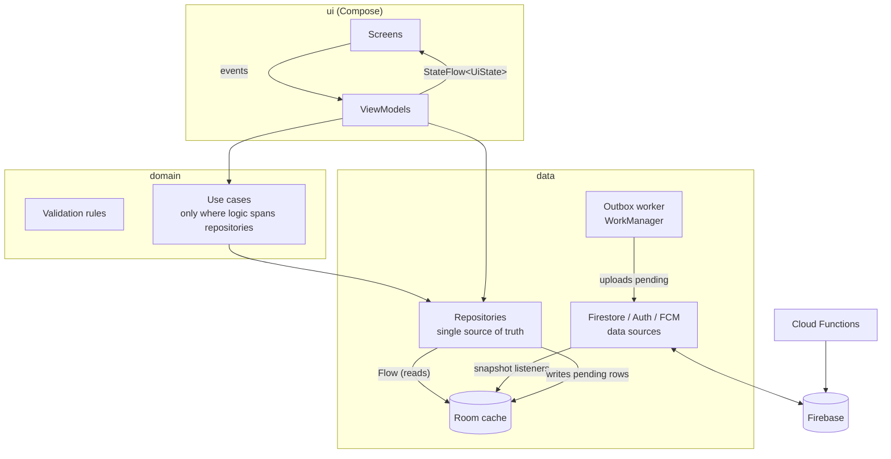

# Architecture

**Unidirectional data flow:** the UI sends events to the ViewModel. The ViewModel calls
repositories and exposes one immutable `UiState` per screen. The UI only reads Room via
repository `Flow`s. Remote changes always arrive through Room, so the UI works the same
online and offline.

Status: the M1 skeleton (theme, navigation, DI, CI) is in place; the data layer arrives in M2–M4.
